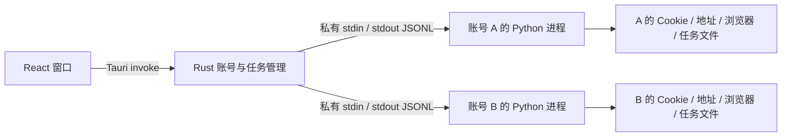

# 架构与运行约定

无需本地 HTTP 服务。UI 只有特定 Tauri 命令权限，不提供任意 shell、任意文件访问或远端页面执行权限。已有 Python 协议保持可回归，Rust 负责跨平台应用生命周期与隔离；没有为了 Rust 重写 SRP 或猜测 Apple 私有协议。

## 任务协议

每个事件包含 `v: 1`、`account_id`、`task_id`。Rust 不接受账号或任务标识不匹配的事件。

- Rust 首行发送账号、动作和参数。所有路径由 Rust 的应用目录及 UUID 推导；用户不能通过命令参数指定其他账号的目录。
- worker 发出 `stage`、`log`、`prompt`、`result`、`error` 或 `cancelled`。
- `prompt` 包含随机 `id` 与 `kind`：密码、验证码、文本、选项或下单确认。选项使用服务端真实值，确认的响应必须是布尔值。
- 回复带有账号、任务和提示 ID，过期提示或另一账号的输入被拒绝。前端和 Rust 均避免“清理旧提示时抹掉刚到的新提示”的竞态。
- 密码、验证码经内存管道传递，不出现在命令行、任务日志或 JSON 文件。需要保存密码时使用系统原生凭据保险库，没有纯文本回退。

worker 可逐步改为 Rust 实现，只需保持动作及事件协议；当前没有必要同时维护两套登录算法。

## 顺序与取消

账号新增记录先带 `pending: true`，只作为未完成添加的草稿。`enroll` 完成原有完整商城登录并通过账户信息查询后，Rust 才将其改为已添加；登录错误、取消和中断不会完成添加。旧账号记录兼容默认 `pending: false`，仍需每次启动时通过用户勾选后的检查。

前端每次启动不默认启用任何账号。仅对勾选账号按顺序发起 `me`，等待当前任务（包括密码和二次验证）结束后再检查下一账号。只将本轮检查通过的账号放入工作台。`me` 复用 Python 的账户页重新认证；查询失败且尚未进入认证时最多补一次完整登录，密码/验证码拒绝不会形成重试循环。完整登录失败时不把原来的内存 Cookie 写回覆盖已清理的认证文件。

worker 用认证失败阶段标记和结构化 `account_invalid` 错误报告重新认证失败，网络超时、429、常规 5xx、取消及非认证业务错误不触发移除。Rust 只移除已完成添加的账号，并取消它排队中的任务；`account_removed` 结果让界面移除账号并显示提示，保持路由不变。worker 删除该账号的认证文件并尝试清理系统保存的密码，历史订单与地址保留；重新添加分配新 UUID。首次添加草稿及已进入订单提交阶段的任务不适用自动移除规则。

`me` 和 `enroll` 返回经过确认的账号信息后，Rust 保存 API 昵称，空昵称回退到邮箱；前端用同一结果同步显示，不额外请求昵称。

每个账号有自己的独占许可，不设置全局并行账号上限。一个账号排队不占用其他账号的执行许可。OTP / 人工确认等待期间保留进程和会话，其他账号继续运行。队列和运行任务均可取消。回归测试同时持有八个账号许可，并验证同一账号排队和取消。

关闭应用时发送取消，等待清理，终止应用自己启动的进程。账号浏览器 PID 由 worker 显式报告；不按进程名称批量杀系统 Chrome。系统强制结束整个应用或断电仍可能中断外部操作，因此重启只恢复历史状态，不自动续跑。

创建订单前记录提交阶段；服务端返回支付链接后先落盘，再获取二维码。请求失败、取消或进程退出都不能证明远端订单未创建，需要用户查询订单。没有自动“恢复旧订单后才允许加购”的额外阻塞流程。

任务日志各自保存，最多 100 条过程记录进入界面快照。历史中移除二维码 data URL 和支付 URL；原始支付信息只存在相应账号的任务目录。目录和文件写入以原子替换为主，避免中断产生半个 JSON。

## 平台边界

macOS 使用 WKWebView，Windows 使用 WebView2 展示界面；它们不承担 Apple 认证上下文。需要时另启安装好的 Chrome 或 Edge，使用账号私有资料，保留旧脚本的上下文获取行为。

PyInstaller 的单目录包作为 Tauri 资源携带，Rust 使用固定资源路径启动，无系统 Python 依赖。分别在相应平台/架构构建，不能把 macOS 的 Python 二进制放进 Windows 安装包。

## 验证边界

已覆盖离线业务回归、两个 worker 同时写不同账号目录、旧输入丢弃、取消输入等待、错误密码清理、导入 Cookie 校验、明确下单确认，以及 Rust 的排队/取消和 UI 的账号切换。真实账号登录、Apple 服务端 541、库存、配送与真实支付仍需使用者在自己的账号上验证；没有把离线桩结果标注为真实商城成功。

Windows 和 Intel macOS 的构建工作流已配置。只有实际相应 runner / 实机成功后，才能将该平台标记为已验证。

## 构建故障记录

本机 Xcode 27 / Rust 1.97.1 的发布构建曾报 `can't find crate for tauri_macros`。检查宏动态库后得到 `mis-aligned LINKEDIT string pool`，与 Rust/LLVM 剥离调试信息的已知问题一致。`Cargo.toml` 显式关闭 release 和构建依赖的 strip，避免生成无法加载的宏动态库；不是应用业务依赖缺失。上游记录：[rust-lang/rust #157750](https://github.com/rust-lang/rust/issues/157750)。

## 登录前页面和预设

前端使用 Hash 路由 `#/settings` 与 `#/duo`，桌面和 Web 共用。公开任务使用保留的 nil UUID 表示本地工作空间，不进入 Apple 账号目录；Rust 和 worker 都只允许该作用域执行匿名 catalog 和本地 address_read/address_save。任务及模板保存在 `settings/`，不读取其他账号 Cookie，不触发登录。Web 的本机访问令牌和来源校验仍生效。

通用购买预设通过 `save_preset` 写入 `settings/purchase.json`；通用地址写入 `settings/checkout.json`。新增账号创建时复制预设，已有账号不跟随模板变化。账号专用设置仍写自己的目录。DUO 页面复用原 `query_duo` 解析器，SKU 预制数据仅做默认展示和快捷选择，实时失败与未返回 SKU 均不推断库存。

## 按账号保存的下单模板

下单模板使用独立的 `accounts/<uuid>/order-templates.json`，格式版本 `schema_version: 1`，包含模板列表、默认模板 ID 和逐模板 revision。旧 `purchase.json` / `checkout.json` 的格式不变；导入仅复制购买参数和联系人、地区、地址字段，不导入密码或会话。文件沿用原子写入和私有权限，未知格式版本拒绝读取，过期 revision 拒绝覆盖。

桌面 IPC 与本地 Web 共用 `list_templates`、`template_source`、`save_template`、`delete_template`。`start_task(purchase, {template_id})` 在 Rust 中读取当前账号保存的模板，固定快照后排队；浏览器不能直接提供 `order_template` 覆盖后端模板。同账号已有下单任务时拒绝再次发起模板订单。

worker 的 `order_template.TemplatePolicy` 在登录或网络操作前校验完整配置。执行时将联系人和地址写入当前任务的 `template-checkout.json`，不修改账号原有快捷地址。业务选择由结构化字段确定：收货方式、地址来源、官网完整地址匹配、配送服务策略与累计运费上限、门店和取货时间、发票、SKU 替代白名单与订单总额上限。地址 ID、库存和带签名的时段仅取自当前官网响应。

`worker/data/apple-retail-cn.json` 为前端和 worker 共用的中国大陆直营店目录，随两种发行包内置。`pickup.store_ids` 是有顺序的门店编号数组，后端校验编号存在、无重复且属于配置城市；旧 `pickup.store` 单门店仍可读取执行。新多门店流程先尝试原 SKU 的门店次序，全部不可用才使用 SKU 白名单；接口失败、未知可选状态和签名异常停止，只有已知不可取状态才切换。详见 `docs/PICKUP_STORES.md`。

模板模式下未覆盖的业务 `text/select/confirm` 一律失败并指明配置缺口，不退回默认选择或交互；Apple 登录密码与临时验证码仍通过原有认证通道。模板总额允许包含符合运费上限的配送费用；复核仍要求商品、数量、支付宝、收货安排及总额通过校验。订单提交和支付二维码恢复沿用原有单次提交规则。

本地验证采用临时账号目录和合成官网模型，不对真实账号发起加购、下单或支付。模拟结果不能作为 Apple 实际库存、真实交易成功或下单耗时的证明。
